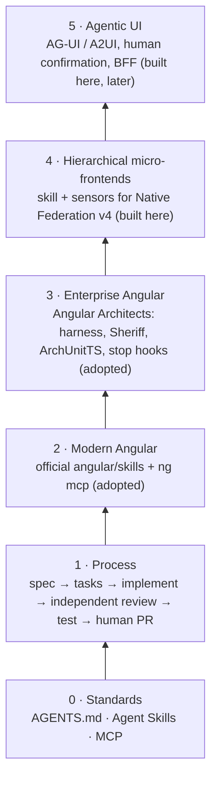
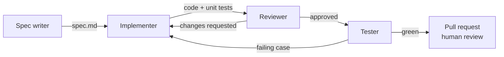

# Angular Agent Factory

A small, opinionated factory of AI agents specialised in **modern Angular** (v20+): they turn a written spec into a reviewed, tested feature, following explicit rules, skills and sensors.

It is the factory behind [`angular-lab`](https://github.com/Horizon-Code/angular-lab), a hierarchical micro-frontend workspace where every feature is specified, built, reviewed and tested by these agents, with a human (me) accountable for what ships.

> Agents accelerate the work. People stay accountable for what gets merged.

## Why

Coding assistants are good at writing code and bad at knowing *your* rules: which state pattern you use, where business rules live, how errors must be shown, which micro-frontend may import what, what "done" means. This factory makes those rules explicit, splits the work into roles, and checks the result with sensors instead of trusting the agent's word.

## Layers

The factory is organised in layers. It **adopts** what already exists (open standards, the official Angular skills, Angular Architects' enterprise practices) and **only builds what nobody publishes**: hierarchical micro-frontends with Native Federation, and agentic UI in Angular.



| Layer | What it is | Source | Status |
|---|---|---|---|
| 0 · Standards | [`AGENTS.md`](AGENTS.md) as the contract every agent reads; skills in the open Agent Skills format; tools over MCP. Works in Claude Code, Codex, Cursor or Antigravity. | Open standards | `AGENTS.md` in place; skills format and MCP wiring in progress |
| 1 · Process | Four roles with one job each, gates and hand-offs: [`WORKFLOW.md`](WORKFLOW.md). | Own, informed by Spec Kit and spec-driven practice | v0.1 |
| 2 · Modern Angular | The official [Angular agent skills](https://angular.dev/ai/agent-skills) and the Angular CLI MCP server (`ng mcp`). Installed, not duplicated. | Angular team | Being evaluated in the lab |
| 3 · Enterprise Angular | Architecture as an executable contract: boundary rules loaded on demand, [Sheriff](https://github.com/softarc-consulting/sheriff) in lint, stop hooks that run the checks when an agent finishes. | [Angular Architects](https://www.angulararchitects.io/) (Steyer, Thalhammer), credited | Planned |
| 4 · Hierarchical micro-frontends | A skill the implementer and reviewer receive when a task touches federation (one runtime shared through DI, a manifest per level, `./routes` only, fail-soft loading), plus sensors: boundaries per level, a smoke test that boots all three levels, shared-version checks. Boundary rules start from [`lucamezzalira/mfe-skills`](https://github.com/lucamezzalira/mfe-skills) (MIT). | Built here | Knowledge in [`knowledge/angular/micro-frontends.md`](knowledge/angular/micro-frontends.md); skill and sensors in progress |
| 5 · Agentic UI | A skill for bringing agents into Angular apps: AG-UI events, A2UI, human-in-the-loop interrupts before any irreversible action, a trusted BFF in front of the agent. | Built here | Arrives with the lab's first agentic flow |

## How a feature is built (layer 1)



| Agent | Input | Output | Done when |
|---|---|---|---|
| [`spec-writer`](agents/spec-writer.md) | A one-paragraph request | `specs/<feature>.md` from the [spec template](templates/spec.md) | Every business rule, state and error case is written down with an acceptance criterion |
| [`implementer`](agents/implementer.md) | An approved spec | Code + unit tests in the target repo | All acceptance criteria are covered, build and lint pass |
| [`reviewer`](agents/reviewer.md) | The diff + the spec | Review notes, approve or request changes | The [review checklist](agents/reviewer.md#checklist) passes |
| [`tester`](agents/tester.md) | The approved diff | E2E tests for the acceptance criteria | Every criterion has a passing test; unhappy paths included |

The reviewer runs in a fresh context: it has not seen the implementer's reasoning, only the spec, the diff and the rules.

## What the agents know

- [`AGENTS.md`](AGENTS.md) — the house rules every agent obeys.
- [`knowledge/angular/`](knowledge/angular) — how we use signals, state, micro-frontends and testing, with the reasons.

The factory contains **no industry knowledge**. Business rules — finance, health, anything — belong to the project that uses them and live in that project's own `AGENTS.md` and docs, which win over the factory's. [angular-lab](https://github.com/Horizon-Code/angular-lab/blob/main/AGENTS.md) is a worked example: its finance rules live there, not here.

Knowledge is plain Markdown on purpose: reviewable in a PR, diffable, and readable by people as well as models. It is kept current every month against primary sources (Angular releases, Native Federation, NgRx, Vitest, Playwright).

## Use it in your project

```bash
# from the root of your Angular workspace
npx degit Horizon-Code/angular-agent-factory .factory
.factory/scripts/install.sh
```

`install.sh` copies the agents into `.claude/agents/`, and `AGENTS.md`, `knowledge/` and `templates/` into `.factory/`, so your repo keeps a pinned, reviewable copy. Then add your project's own rules (app names, domain rules) to your root `AGENTS.md`.

## Principles

1. **Spec first.** No code without an approved spec with acceptance criteria.
2. **One job per agent.** Narrow roles produce checkable outputs.
3. **Sensors over promises.** A rule that can be checked by a tool is checked by a tool, not by asking the agent.
4. **Adopt before building.** Official skills and proven practices first; the factory only writes what does not exist.
5. **The frontend informs, the backend decides.** Client-side checks guide the user; the server has the final word.
6. **Humans merge.** Every change ends in a pull request a person is accountable for.

### Decisions worth reading

- **No industry packs in the factory.** Domain rules (e.g. finance orders) moved to the project that needs them. A reusable tool should not ship one project's business rules; the factory stays Angular-only and works for any domain.
- **Adopt, then specialise.** Generic Angular guidance comes from the Angular team's own skills and enterprise architecture from Angular Architects. The factory's own work is layers 4 and 5, where nothing equivalent is published for Angular.

## Status

v0.1 — layer 1 (four agents, workflow, templates) and the Angular knowledge base. Next: adopt layers 2–3 and build the layer-4 skill and sensors, driven by what the lab needs. Target for v1: layers 0–4 proven end to end on at least three lab features. Under consideration: a `migrator` agent (Angular upgrades, NgModule → standalone), added only when the lab needs it.

## License

MIT
