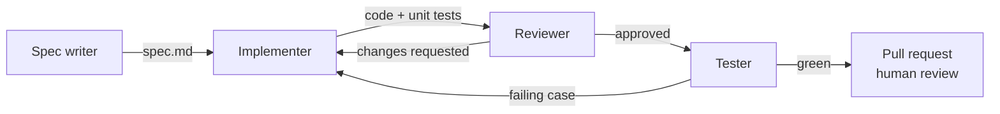

# Angular Agent Factory

A small, opinionated factory of AI agents specialised in **modern Angular** (v20+): they turn a written spec into a reviewed, tested feature, following explicit rules and a curated knowledge base.

It is the factory behind [`angular-lab`](https://github.com/Horizon-Code/angular-lab), a multi-level micro-frontend workspace where every feature you see was specified, built, reviewed and tested by these agents, with a human (me) accountable for what ships.

> Agents accelerate the work. People stay accountable for what gets merged.

## Why

Coding assistants are good at writing code and bad at knowing *your* rules: which state pattern you use, where business rules live, how errors must be shown, what "done" means. This factory makes those rules explicit and splits the work into roles, so each agent has one job, one checklist and one output.

## How it works



| Agent | Input | Output | Done when |
|---|---|---|---|
| [`spec-writer`](agents/spec-writer.md) | A one-paragraph request | `specs/<feature>.md` from the [spec template](templates/spec.md) | Every business rule, state and error case is written down with an acceptance criterion |
| [`implementer`](agents/implementer.md) | An approved spec | Code + unit tests in the target repo | All acceptance criteria are covered, build and lint pass |
| [`reviewer`](agents/reviewer.md) | The diff + the spec | Review notes, approve or request changes | The [review checklist](agents/reviewer.md#checklist) passes |
| [`tester`](agents/tester.md) | The approved diff | E2E tests for the acceptance criteria | Every criterion has a passing test; unhappy paths included |

The full workflow, gates and hand-offs are in [WORKFLOW.md](WORKFLOW.md).

## What the agents know

The agents do not rely on generic knowledge. They read:

- [`AGENTS.md`](AGENTS.md) — the house rules every agent obeys.
- [`knowledge/angular/`](knowledge/angular) — how we use signals, state, micro-frontends and testing, with the reasons.
- [`knowledge/domain/`](knowledge/domain) — optional **domain packs**: rules that are easy to get wrong in a given industry. The first pack is [finance orders](knowledge/domain/finance-orders.md) (buy and sell journeys for equities and ETFs).

Everything here is project-agnostic. Rules that belong to one project — its app names, ports, helpers — live in that project's own `AGENTS.md`, which wins over the factory's. [angular-lab's `AGENTS.md`](https://github.com/Horizon-Code/angular-lab/blob/main/AGENTS.md) is a worked example.

Knowledge is plain Markdown on purpose: reviewable in a PR, diffable, and readable by people as well as models.

## Use it in your project

The agents are written as [Claude Code subagents](https://docs.claude.com/en/docs/claude-code/sub-agents), but the files are plain Markdown and can be adapted to any agent runner.

```bash
# from the root of your Angular workspace
npx degit Horizon-Code/angular-agent-factory .factory
.factory/scripts/install.sh
```

`install.sh` copies the agents into `.claude/agents/`, and `AGENTS.md`, `knowledge/` and `templates/` into `.factory/`, so your repo keeps a pinned, reviewable copy. Then add your project's own rules to your root `AGENTS.md`.

## Principles

1. **Spec first.** No code without an approved spec with acceptance criteria.
2. **One job per agent.** Narrow roles produce checkable outputs.
3. **The frontend informs, the backend decides.** Client-side checks guide the user; the server has the final word.
4. **Never lie to the user.** An error is shown as an error, never as an empty list.
5. **Tests are part of the feature**, not a follow-up.
6. **Humans merge.** Every change ends in a pull request a person reviews.

## Status

v0.1 — four core agents, Angular knowledge base and workflow. Next: a `migrator` agent (Angular version upgrades and NgModule → standalone) driven by what the lab needs.

## License

MIT
